<p align="center">
  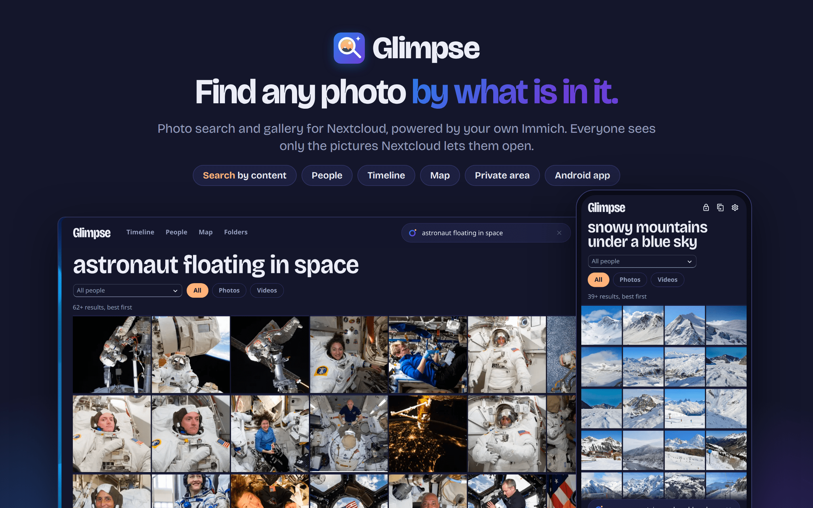
</p>

<h1 align="center">Glimpse</h1>

<p align="center">
  <b>Find any photo in your Nextcloud by what is in it.</b><br>
  Type "dog in the snow" or a person's name, browse a timeline, a map and your folders.<br>
  The understanding comes from your own <a href="https://immich.app">Immich</a>; who sees what is decided by Nextcloud.
</p>

<p align="center">
  <a href="https://github.com/Infraviored/nextcloud-immich-search/actions/workflows/ci.yml"></a>
  
  
  
  <a href="LICENSE"></a>
</p>

---

Nextcloud keeps your photos, but finding one means remembering the folder. Immich understands
pictures (what is in them, who is in them) but wants to own your library and has its own
accounts. **Glimpse puts Immich's understanding on top of the files you already have in
Nextcloud.** Immich indexes them read-only. Glimpse adds the interface, Nextcloud's search
integration and the permission checks.

## What it does

- **Search by content.** Describe the picture: "birthday cake", "lighthouse at sunset", "red
  bicycle". Results are ranked by Immich's CLIP model. "More like this" works on any picture.
- **Search inside videos.** Immich understands a video by a single still. Glimpse extracts
  extra stills (every ~15 s, up to 40 per video) using ffmpeg and hands them to Immich as
  archived pictures. Text search finds the moment, opening the video right there.
- **Search by person.** Name a person, or combine a name with words: "Tara beach" finds Tara's
  beach pictures. You can also filter by tag, and show only photos or only videos.
- **Timeline.** All your pictures by month in year bands, with a year rail to jump anywhere,
  "On this day" cards, and "Back to today".
- **People.** Name, merge, hide and favorite people. Assign or remove single faces, or move
  many faces out of a person at once ("Not Tanja"). "Label people" lets you name faces one
  after another.
- **Map.** Geotagged pictures in clusters on OpenStreetMap, with the pictures of the visible
  area below. Tiles are fetched by your server, so browsers never contact the tile server.
- **Folders.** Any Nextcloud folder as a gallery.
- **Duplicates.** Groups of identical or nearly identical pictures. Immich's suggestion of what
  to keep is preselected; the rest goes to the trash bin.
- **Sort in bulk.** Select many pictures (long-press on touch) and act on all of them:
  - move or copy into folders, with recent targets and undo
  - tag or favorite
  - add to a Photos album and share it
  - download as ZIP
  - delete
- **Private area.** Folders, people and single pictures that only appear after you unlock with
  your password. They never appear in the global search or on the dashboard.
- **All over Nextcloud.**
  - "Photos by content" and "People in photos" in the search bar, also in the mobile apps
  - in Files, a "Similar pictures" action and a "People" tab in the sidebar
  - an "On this day" dashboard widget
- **Android app.** [Glimpse for Android](https://github.com/Infraviored/glimpse-android) is a
  native app with timeline, search, people and folders. You log in with Nextcloud's own login
  page.
- **Light and dark.** The app follows your Nextcloud theme.

Everything is a real Nextcloud file: clicking opens the Nextcloud viewer (videos play), and
every action goes through Nextcloud with your own permissions.

## Screenshots

| | |
|---|---|
| 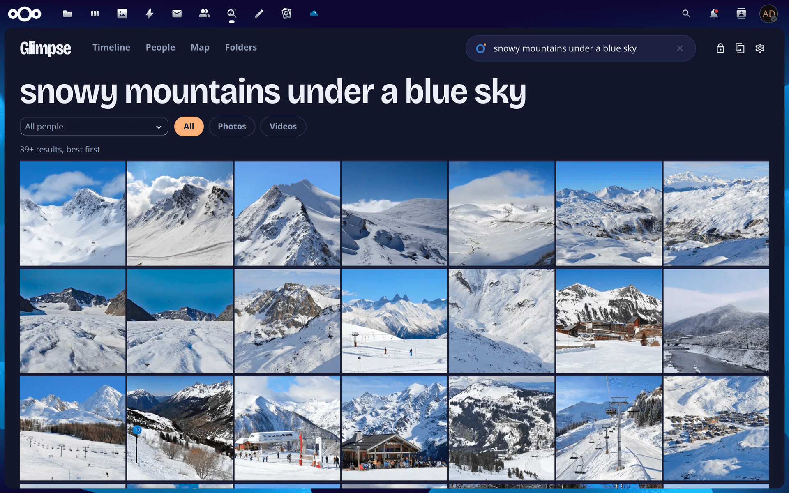 | 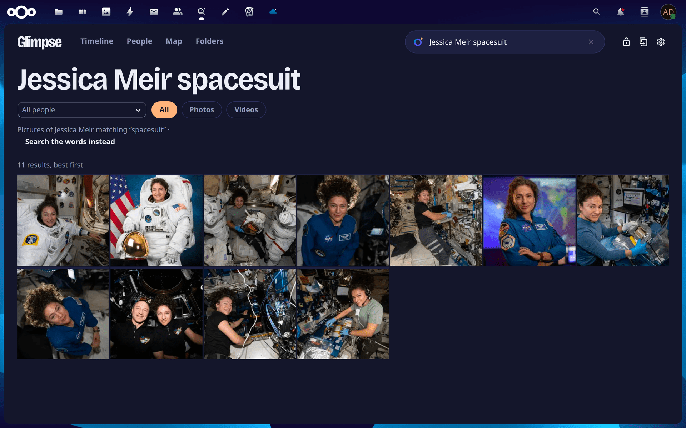 |
| **Search by content.** No tags, no captions: Immich's CLIP model reads the pictures. | **Person + words.** "Jessica Meir spacesuit" is split into a person and a query. |
| 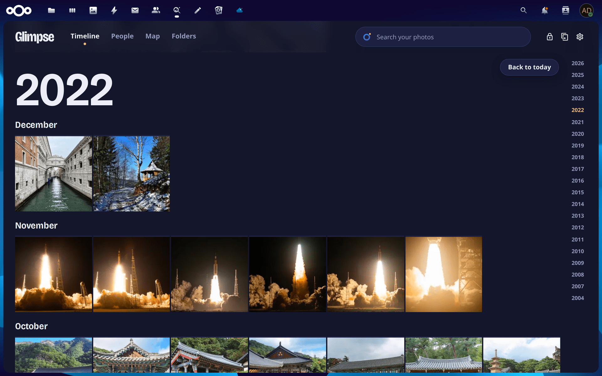 | 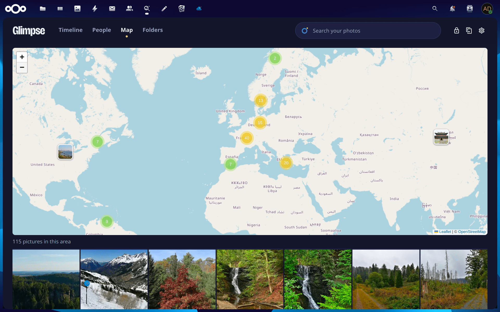 |
| **Timeline** in year bands; the rail jumps to any year. | **Map** of everything geotagged, clustered. |
| 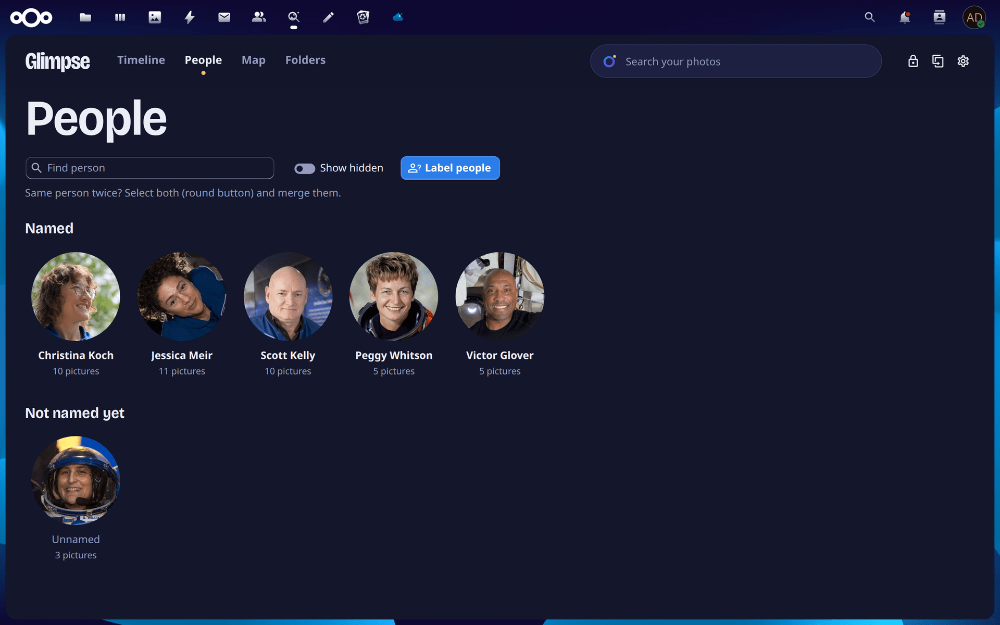 | 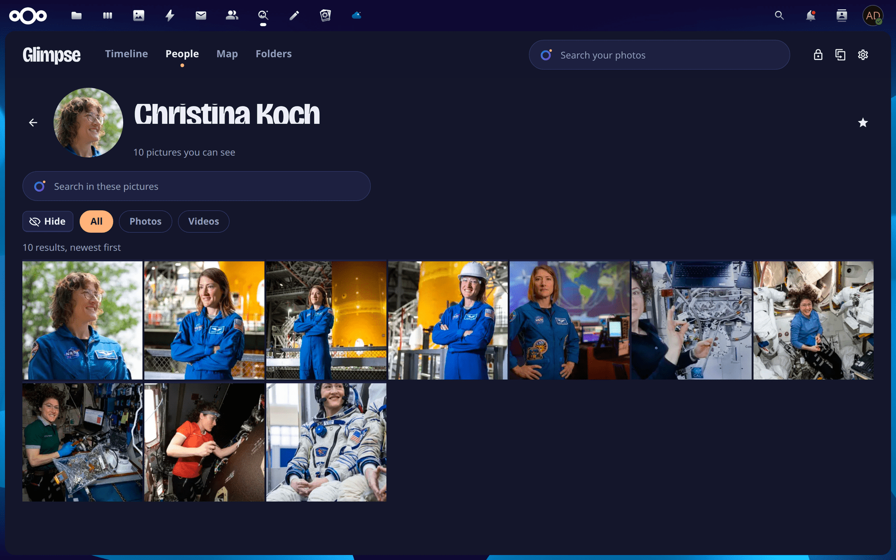 |
| **People**, with faces cut only from pictures you can open. | **A person's page**, searchable on its own. |
| 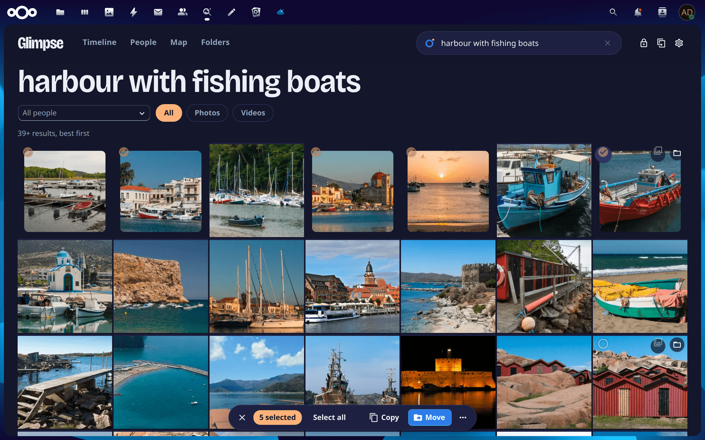 | 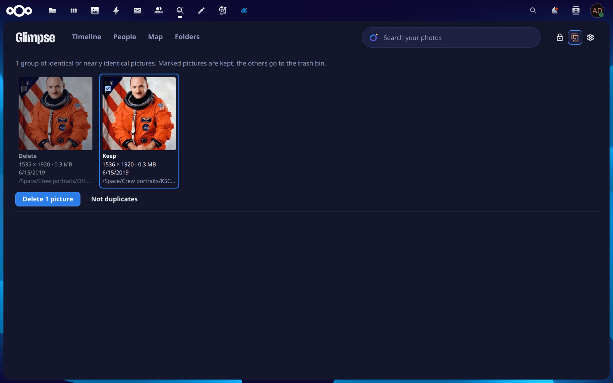 |
| **Bulk actions** from a floating bar. | **Duplicates** with Immich's suggestion preselected. |
| 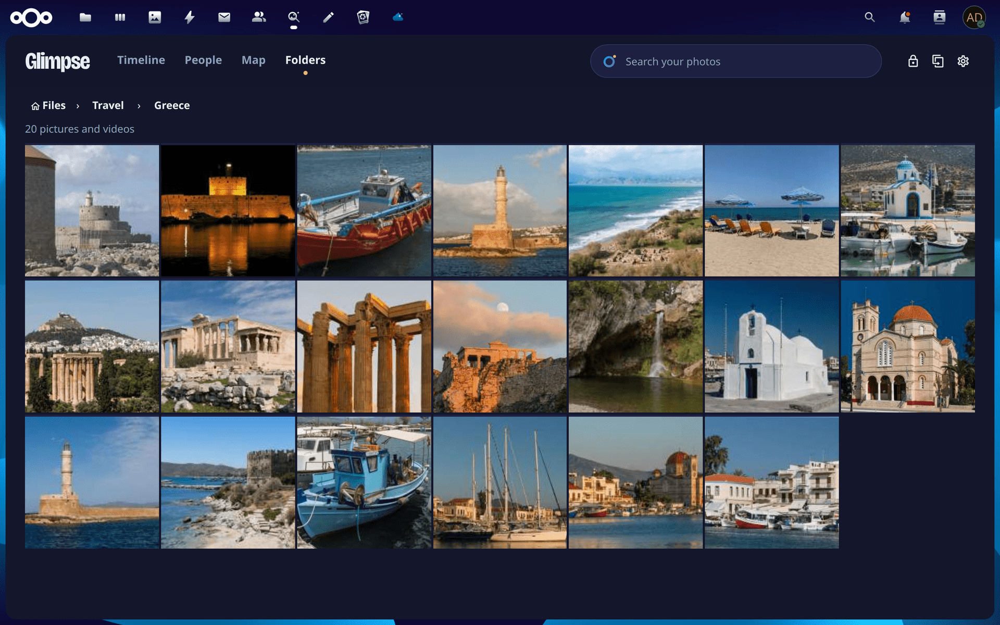 | 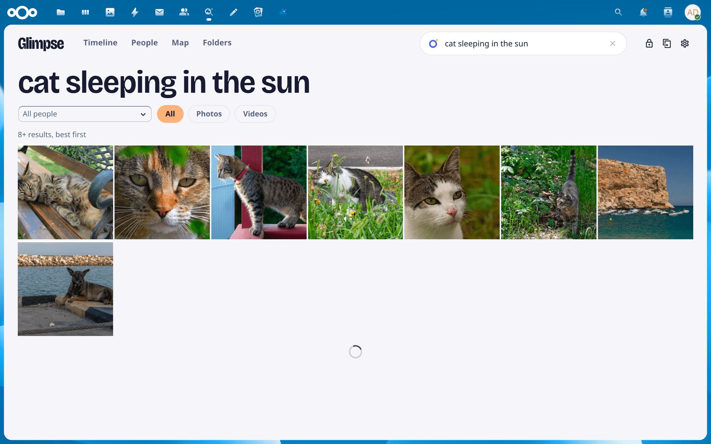 |
| **Folders** as galleries. | **Light theme** when Nextcloud is light. |

<p align="center">
  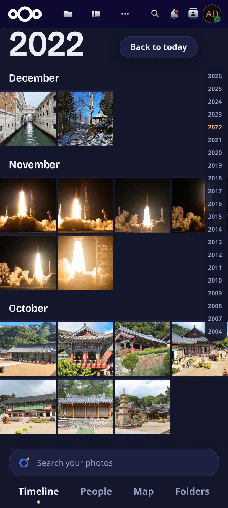
  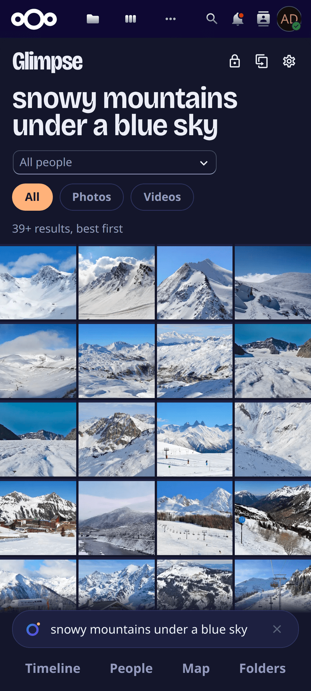
  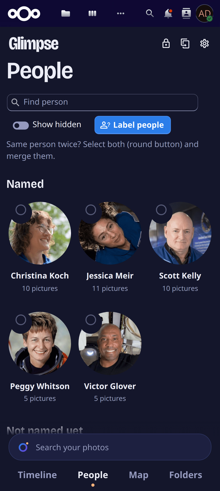
  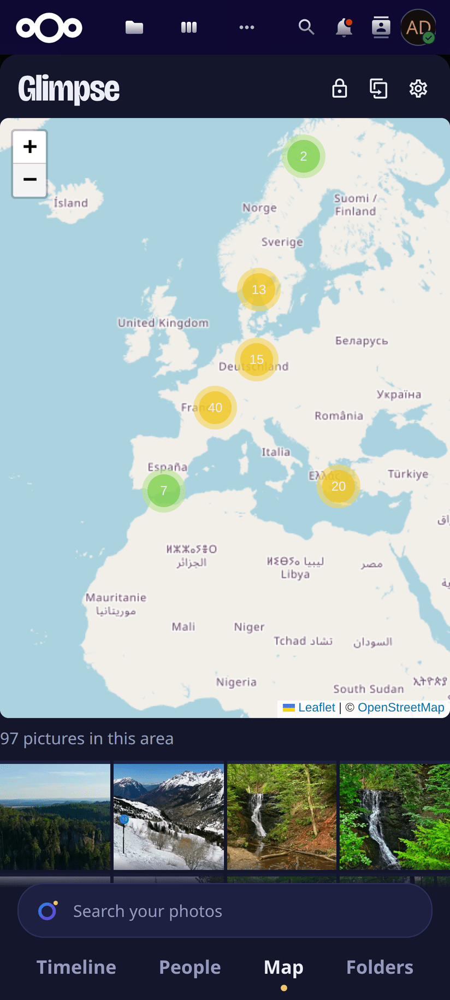
</p>
<p align="center"><sub>The web app on a phone: search and tabs sit at the bottom, where the thumb is.</sub></p>

<sub>All screenshots come from a demo account holding only public-domain (NASA) and CC0
(Wikimedia Commons) photos. See [docs/screenshots/CREDITS.md](docs/screenshots/CREDITS.md).</sub>

## Who sees what

Immich indexes everyone's files under one service account. **Nextcloud still decides.** For every
hit, Glimpse maps Immich's path back to the owner's file and checks that the person searching
can open that file in Nextcloud, either as their own file or through a share. Hits that fail
the check are dropped, together with:

- their thumbnail
- their faces
- their map marker
- their place in memories and duplicates

Recipients of a share see the files under their own paths.

- **People** are listed for you only if they appear in a picture you can open. The face shown
  is cut from such a picture, never from Immich's own person thumbnail.
- **Shared between users:**
  - person names (there is one Immich account, so a name someone types is seen by everyone who
    can see that person)
  - the list of years that have pictures

  Admins decide who may name, merge and hide people.
- **The private area** is per user, on top of all this. It hides things from view; it is not
  encryption.

Details: [docs/SECURITY.md](docs/SECURITY.md).

## Requirements

- **Nextcloud** 30 to 35 with background jobs (cron) running. Nextcloud AIO runs cron by
  itself.
- **PHP** 8.1 or newer.
- **ffmpeg** on the Nextcloud server (for search inside videos; `/usr/bin/ffmpeg`,
  `/usr/local/bin/ffmpeg`, or `/bin/ffmpeg`).
- **Immich**, self-hosted, with its machine-learning service. Tested with Immich 3.2.
  - Smart search (CLIP) is needed for content search.
  - Face detection and recognition are needed for people.
  - Duplicate detection is needed for duplicates.
- **Read access for Immich** to the Nextcloud data directory, mounted read-only into the Immich
  container.
- Optional:
  - the Photos app, for "Add to album"
  - the Memories app, for "Open in Memories"
  - the PHP extension `pdo_pgsql` plus network access to Immich's Postgres, to keep pictures
    when they are moved (step 5 below)

## Install

### 1. Give Immich read-only access to the files

Mount each user's Nextcloud files into the Immich server container, read-only. For example, in
Immich's `docker-compose.yml`:

```yaml
  immich-server:
    volumes:
      - /srv/nextcloud-data/alice/files:/mnt/nextcloud/alice:ro
      - /srv/nextcloud-data/bob/files:/mnt/nextcloud/bob:ro
```

For **Nextcloud AIO**, the data directory is the volume `nextcloud_aio_nextcloud_datadir` (or
your `NEXTCLOUD_DATADIR`); mount `<datadir>/<user>/files`. Then run `docker compose up -d
immich-server`.

### 2. Create an API key in Immich

As the Immich account that should own the libraries, open *Account settings → API keys* and
create a key with the permission **all**.

### 3. Install and connect the app

- **From the App Store:** in Nextcloud, open *Apps*, search for "Glimpse", and choose
  *Download and enable*.
- **By hand:** unpack the release tarball from
  [Releases](https://github.com/Infraviored/nextcloud-immich-search/releases) into
  `custom_apps/`, then run `occ app:enable glimpse`.

Then open Glimpse and go to *Settings → Connection*, or *Administration settings → Glimpse
(Immich)*. Enter three things:

- the Immich address, e.g. `http://immich:2283`
- the API key
- the path under which Immich sees a user's files, e.g. `/mnt/nextcloud/{user}/`. Here
  `{user}` stands for the Nextcloud user ID.

*Test connection* checks the key before anything is saved. The same works on the command line;
the key is read from stdin, so it never shows in a process list:

```bash
occ glimpse:configure --url http://immich:2283 --key-stdin < api-key
occ glimpse:configure --path-pattern '/mnt/nextcloud/{user}/'    # the default
```

The key is stored encrypted and never sent to the browser.

### 4. Create the libraries

Go to *Settings → What gets indexed → Libraries per user*. It lists the users that have no
Immich library yet. For each user, it shows the `volumes:` line that user needs and a *Create
library* button. The mount from step 1 must exist first.

Immich then scans and analyses the pictures. *Settings → Status* shows the queues. People and
the map follow with the next hourly index, or right away with *Update people now*.

### 5. Optional: keep pictures when they are moved

Immich knows the files of an external library only by their path. A picture or folder that is
moved or renamed gets imported again and analysed from scratch, and faces you assigned by hand
are lost. Glimpse can carry each move in Nextcloud over to Immich's database. To set this up:

1. Give the Nextcloud container network access to Immich's Postgres.
2. Create a role that may touch only asset paths:

   ```sql
   CREATE ROLE nextcloud_moves LOGIN PASSWORD '…';
   GRANT CONNECT ON DATABASE immich TO nextcloud_moves;
   GRANT USAGE ON SCHEMA public TO nextcloud_moves;
   GRANT SELECT (id, "originalPath", "libraryId", "checksumAlgorithm") ON asset TO nextcloud_moves;
   GRANT UPDATE ("originalPath", "originalFileName", checksum) ON asset TO nextcloud_moves;
   ```

3. Configure Glimpse with that role:

   ```bash
   occ glimpse:configure --db-host immich_postgres --db-user nextcloud_moves --db-password-stdin < password
   ```

If the database cannot be reached, moving still works. Immich just analyses the picture again
at its next scan.

## Configuration

Admins configure everything in the app under *Settings*:

| Section | What you set |
|---|---|
| Connection | Immich address, API key, path pattern; optional health check of the machine-learning service |
| What gets indexed | File types and folders Immich should skip (with suggestions for icon and cache folders); minimum picture size (default 256 px), with the option to take smaller images out of Immich for good; search inside videos toggle (`video_scenes`) and night window (`video_scenes_hours`); libraries per user |
| People | Who may name, merge and hide people (everyone, admins or nobody); minimum number of pictures for unnamed people; how often the people index is rebuilt (every 1 h, 6 h or 24 h) |
| Nextcloud search | Whether the search bar shows photos and people, from how many characters, and where in the results |

### Search inside videos

Immich understands videos through a single still taken from the start. With *Search inside videos*
enabled:

1. Glimpse cuts stills from each video (roughly every 15 s, up to 40 per video) using `ffmpeg`
   on the Nextcloud server.
2. Stills are uploaded to Immich via its API with `visibility: archive` and named
   `glimpse-frame_<video>_<ms>.jpg`. They stay in Immich's archive, out of its timeline,
   and never show up in Glimpse's timeline, people or map.
3. Immich's CLIP model analyses the stills like any other photo.
4. Searches in Glimpse match these stills and resolve them back to the source video, opening it
   at that exact timestamp.

Configuration:
- **Toggle:** Enable under *Settings → What gets indexed → Search inside videos* (setting `video_scenes`).
- **Night window:** Setting `video_scenes_hours` (default `2-7`, 2:00 to 7:00 AM) keeps the extraction at night, in the server's local time (the container's `TZ`, else `default_timezone`). Options include `2-7`, `0-6`, `1-6`, `23-6`, `22-6`, `0-7`, `0-24`, or disabled.
- **Background indexing:** The `IndexVideoScenes` job runs every 5 minutes (for up to 2 minutes) during the night window, and purges orphaned stills once a day.
- **Command line:**
  ```bash
  occ glimpse:video-scenes [--minutes=60] [--limit=N]  # extract stills now
  occ glimpse:video-scenes --status                     # show indexing progress
  occ glimpse:video-scenes --orphans                    # remove stills of deleted videos
  occ glimpse:video-scenes --purge                      # remove all stills created by Glimpse
  ```

Every user can set:

| Section | What you set |
|---|---|
| Display | Tile size, start view, whether videos are included by default |
| Nextcloud search | Whether your own search bar shows photos |
| Private | Your private folders and people, and whether unlocking asks for your password |

### Background jobs and commands

| What | When | By hand |
|---|---|---|
| People and map index | hourly (or 6 h / 24 h), skipped when nothing changed | `occ glimpse:people-index` |
| Video scene indexing | every 5 minutes (up to 2 min budget) in night window | `occ glimpse:video-scenes [--minutes=N] [--limit=N]` |
| Take tiny images out of Immich | every 15 minutes, new images only | `occ glimpse:prune [--full] [--reset]` |
| Map tile cache cleanup | daily | – |
| Connection | – | `occ glimpse:configure` |

## FAQ and troubleshooting

**The search finds nothing, but the timeline works.**
Content search needs Immich's machine-learning service. As an admin, look at *Settings →
Status*. It shows how much is still queued. If you set a health-check address under *Settings →
Connection*, it also shows whether the service answers. If the service is
down, the Nextcloud search bar simply shows no photos.

**New pictures don't show up.**
Immich picks up new files with its library scan, which runs nightly by default. *Settings →
Status → Scan libraries now* starts one right away. People and the map follow with the next
index run.

**A user sees no people or no map.**
Both come from a background index that is rebuilt hourly by default. Check that Nextcloud's
cron runs, or start a rebuild with *Update people now*.

**A user sees pictures that aren't theirs.**
They shouldn't. Glimpse only shows files that resolve in that user's own Nextcloud tree. Check
whether the files were shared with them, for example through a group, a circle, a Talk room or
a Deck board. If not, please report it privately.

**"Libraries per user" doesn't list a user.**
The list only contains users who have logged in at least once and who are enabled.

**Can I undo a merge of two people?**
No. Immich has no way to split people again.

**Does Glimpse change my files?**
Only when you ask it to (move, copy, tag, favorite, delete), and always as you, through
Nextcloud. Immich only reads the files.

## Development

PHP backend (controllers and services under `lib/`), Vue 3 frontend with `@nextcloud/vue`
(under `src/`, built by Vite into `js/`).

```bash
make build      # npm install + vite build into js/
make test       # PHPUnit (against nextcloud/ocp stubs, no server needed) + Vitest
make lint       # PHP syntax + translation JSON
npm run lint    # ESLint (@nextcloud/eslint-config)
composer cs:check
make dist       # build/glimpse-<version>.tar.gz
make deploy     # install into a dockerized Nextcloud (CONTAINER=…, default AIO)
NC_URL=… NC_USER=… NC_PASS=<app password> npm run e2e   # live smoke test, pictures blurred
```

`deploy.sh` raises the patch version whenever shipped files change. Nextcloud caches routes,
and browsers cache scripts, per app version. The script reloads php-fpm gracefully to clear the
PHP cache. When the version changed, it then runs Nextcloud's upgrade step, which puts the
instance into maintenance mode for a moment.

CI runs on every push. Tagging `vX.Y.Z` builds a release; see [docs/RELEASE.md](docs/RELEASE.md).
For a map of the code, see [AGENTS.md](AGENTS.md).

## Limits

- New pictures arrive with Immich's library scan. People and the map follow with the next index
  run.
- Immich allows at most 128 exclusion patterns per library, and a pattern longer than about
  10,000 characters makes the scan fail. Glimpse packs and sanitizes its patterns to stay within
  both limits.
- Moves are carried over only when they happen through Nextcloud and the file stays with the
  same owner.

## License

[AGPL-3.0-or-later](LICENSE). The Bricolage Grotesque font in `img/` is under the SIL Open Font
License ([img/bricolage-OFL.txt](img/bricolage-OFL.txt)).
